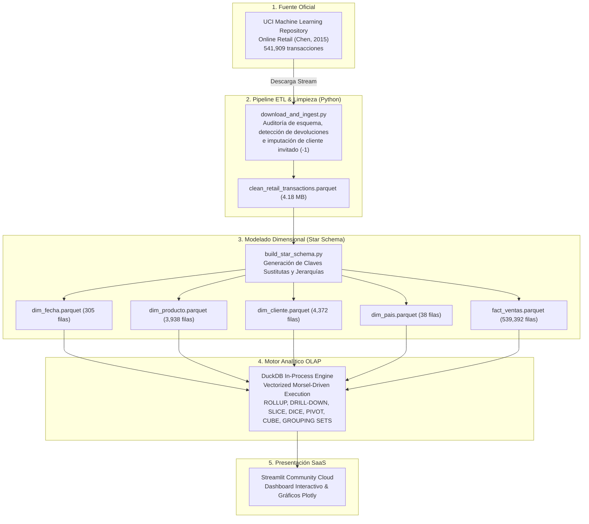
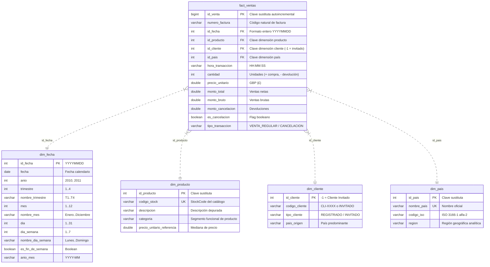

# RetailCube Analytics: Plataforma OLAP con DuckDB, Python y Streamlit

[](https://github.com/Hashiravc/retailcube-olap-duckdb/actions/workflows/ci.yml)
[](https://retailcube-olap-duckdb.streamlit.app)
[](LICENSE)
[](https://duckdb.org)
[](https://python.org)

**RetailCube Analytics** es una plataforma de análisis multidimensional de ventas (OLAP) de alto rendimiento, diseñada con una arquitectura moderna de software libre. Utiliza **DuckDB** como motor analítico in-process, almacenamiento columnar inmutable en **Apache Parquet**, un **Modelo Dimensional tipo Estrella** basado en las metodologías de Ralph Kimball y una interfaz empresarial interactiva en **Streamlit**.

---

## Tabla de Contenidos
1. [Objetivo del Sistema](#objetivo-del-sistema)
2. [Arquitectura Tecnológica](#arquitectura-tecnológica)
3. [Dataset de Origen & Calidad de Datos](#dataset-de-origen--calidad-de-datos)
4. [Diseño del Data Warehouse (Modelo Estrella)](#diseño-del-data-warehouse-modelo-estrella)
5. [Operaciones OLAP Implementadas](#operaciones-olap-implementadas)
6. [Estructura del Repositorio](#estructura-del-repositorio)
7. [Instalación y Ejecución Local](#instalación-y-ejecución-local)
8. [Automatización con GitHub Actions (CI/CD)](#automatización-con-github-actions-cicd)
9. [Despliegue Público](#despliegue-público)
10. [Pruebas Automatizadas y Validación](#pruebas-automatizadas-y-validación)
11. [Enlaces Públicos y Entregables](#enlaces-públicos-y-entregables)

---

## 1. Objetivo del Sistema
Construir una solución analítica integral que permita explorar información histórica de transacciones comerciales desde múltiples perspectivas:
- **Dimensión Tiempo:** Año, Trimestre, Mes, Día de la semana y Fecha.
- **Dimensión Producto:** Artículos, descripción consolidada y categorías funcionales.
- **Dimensión Cliente:** Clientes registrados e invitados/anónimos.
- **Dimensión País:** Mercados internacionales y regiones geográficas.

El sistema ejecuta consultas OLAP reales con SQL nativo sobre DuckDB, garantizando latencias inferiores a 50 milisegundos sin depender de servidores cloud propietarios de pago (como AWS Redshift o Snowflake).

---

## 2. Arquitectura Tecnológica



### Tecnologías Clave:
- **Motor OLAP:** DuckDB v2.0 (ejecución columnar in-process).
- **Almacenamiento:** Apache Parquet (Snappy compression, *predicate pushdown*).
- **Lenguaje:** Python 3.12 / 3.13.
- **Visualización & UI:** Streamlit + Plotly Express.
- **CI/CD:** GitHub Actions (Linux Runners).
- **Hosting SaaS:** Streamlit Community Cloud.

---

## 3. Dataset de Origen & Calidad de Datos

- **Fuente Oficial:** [UCI Machine Learning Repository: Online Retail](https://archive.ics.uci.edu/dataset/352/online-retail)
- **Atribución Académica:** Chen, D. (2015). *Online Retail*. UCI Machine Learning Repository. DOI: [10.24432/C5BW33](https://doi.org/10.24432/C5BW33).
- **Período Registrado:** 01/12/2010 al 09/12/2011 (Transacciones históricas reales auditadas).

### Reglas de Calidad y Limpieza Implementadas:
1. **Detección de Devoluciones:** Facturas que inician con 'C' o cantidades negativas se clasifican con `es_cancelacion = TRUE`, separando métricas de *Ventas Brutas* (£10.67M), *Cancelaciones* (£896K) y *Ventas Netas* (£9.77M).
2. **Preservación de Clientes Invitados:** 135,080 transacciones (24.9%) no poseían `CustomerID`. Se les asignó la clave sustituta dimensional `id_cliente = -1` (`INVITADO`), evitando la pérdida del 25% de la facturación.
3. **Depuración de Registros Anómalos:** Se descartaron 2,517 registros sin precio unitario válido (`UnitPrice <= 0`).

---

## 4. Diseño del Data Warehouse (Modelo Estrella)



---

## 5. Operaciones OLAP Implementadas

Todas las operaciones están respaldadas por consultas SQL nativas en DuckDB (`sql/queries/`) y se ejecutan dinámicamente desde el dashboard:

1. **ROLL-UP (`sql/queries/01_rollup.sql`):** Agregación jerárquica temporal ascendente (Día ➔ Mes ➔ Trimestre ➔ Año) con `GROUP BY ROLLUP(...)`.
2. **DRILL-DOWN (`sql/queries/02_drilldown.sql`):** Desglose hacia el nivel de mayor granularidad (Año ➔ Trimestre ➔ Mes ➔ Día) para un período específico.
3. **SLICE (`sql/queries/03_slice.sql`):** Corte transversal fijando una dimensión a un único valor (ej. `nombre_pais = 'Germany'`).
4. **DICE (`sql/queries/04_dice.sql`):** Subcubo filtrando simultáneamente sobre múltiples dimensiones (Países, Categorías y Trimestres).
5. **PIVOT (`sql/queries/05_pivot.sql`):** Matriz dinámica de doble entrada con la sintaxis nativa `PIVOT` de DuckDB cruzando Países en filas y Trimestres en columnas.
6. **CUBE (`sql/queries/06_cube.sql`):** Cálculo de todas las combinaciones dimensionales ($2^N$ agrupaciones) sobre Región, Categoría y Año con `GROUP BY CUBE(...)`.
7. **GROUPING SETS (`sql/queries/07_grouping_sets.sql`):** Agregaciones selectivas en un único barrido de tabla con `GROUP BY GROUPING SETS(...)`.

---

## 6. Estructura del Repositorio

```text
retailcube-olap-duckdb/
├── .github/
│   └── workflows/
│       ├── ci.yml                 # Workflow de CI: Linting, validación y 17 tests
│       └── data_build.yml         # Pipeline ETL idempotente y generación Parquet
├── .streamlit/
│   └── config.toml                # Configuración visual del servidor Streamlit
├── app/
│   └── streamlit_app.py           # Dashboard interactivo con 7 vistas ejecutivas
├── data/
│   ├── raw/                       # Almacenamiento temporal de datos crudos (ignorado en git)
│   └── processed/                 # Tablas del Esquema Estrella en Parquet (11 MB total)
│       ├── dim_fecha.parquet
│       ├── dim_producto.parquet
│       ├── dim_cliente.parquet
│       ├── dim_pais.parquet
│       └── fact_ventas.parquet
├── deliverables/
│   ├── enlaces.txt                # Enlaces oficiales del proyecto
│   ├── README_ENTREGA.md          # Documento resumen de cumplimiento de requisitos
│   └── guion_video.md             # Guion detallado minuto a minuto para el video demo
├── docs/
│   ├── architecture.md            # Documento formal de arquitectura y decisiones
│   └── articulo-devto.md          # Artículo técnico completo preparado para DEV.to
├── sql/
│   ├── schema/
│   │   └── star_schema.sql        # DDL del modelo estrella en DuckDB
│   └── queries/                   # Consultas SQL reproducibles para las 7 operaciones OLAP
│       ├── 01_rollup.sql
│       ├── 02_drilldown.sql
│       ├── 03_slice.sql
│       ├── 04_dice.sql
│       ├── 05_pivot.sql
│       ├── 06_cube.sql
│       └── 07_grouping_sets.sql
├── src/
│   ├── ingestion/
│   │   └── download_and_ingest.py # Descarga, validación y limpieza de datos
│   ├── transformations/
│   │   └── build_star_schema.py   # Construcción dimensional en DuckDB/Parquet
│   └── olap/
│       └── olap_engine.py         # Motor analítico OLAP con caché y vistas en memoria
├── tests/
│   ├── test_ingestion.py          # Pruebas de esquema y calidad
│   ├── test_star_schema.py        # Pruebas de claves e integridad referencial
│   ├── test_olap_queries.py       # Pruebas funcionales de las 7 operaciones OLAP
│   └── test_dashboard.py          # Pruebas de componentes del dashboard
├── requirements.txt               # Dependencias de producción
├── LICENSE                        # Licencia MIT de software libre
└── README.md                      # Documentación principal en español
```

---

## 7. Instalación y Ejecución Local

### Prerrequisitos
- Python 3.10 o superior (recomendado Python 3.12 o 3.13)
- Git

### Pasos de Instalación:
```bash
# 1. Clonar el repositorio
git clone https://github.com/Hashiravc/retailcube-olap-duckdb.git
cd retailcube-olap-duckdb

# 2. Crear y activar un entorno virtual
python -m venv .venv
# En Windows (PowerShell):
.\.venv\Scripts\Activate.ps1
# En Linux/macOS:
source .venv/bin/activate

# 3. Instalar dependencias
pip install -r requirements.txt

# 4. (Opcional) Ejecutar pipeline de ingestión y construcción de datos
python src/ingestion/download_and_ingest.py
python src/transformations/build_star_schema.py

# 5. Ejecutar la suite de pruebas
pytest -v

# 6. Iniciar la aplicación interactiva
streamlit run app/streamlit_app.py
```

---

## 8. Automatización con GitHub Actions (CI/CD)

El proyecto cuenta con dos workflows en `.github/workflows/`:

1. **`ci.yml` (Integración Continua):**
   - Ejecución automática en cada `push` o `pull_request` a `main`.
   - Valida la sintaxis del código Python y ejecuta la suite de 17 pruebas automatizadas.
2. **`data_build.yml` (Pipeline de Construcción de Datos):**
   - Ejecución manual vía `workflow_dispatch` o cuando se modifican scripts de transformación.
   - Reconstruye los archivos Parquet del modelo estrella y los comitea únicamente si cambiaron (`git diff --staged --quiet`), evitando ciclos infinitos.

---

## 9. Despliegue Público

La plataforma se encuentra desplegada públicamente en **Streamlit Community Cloud**, vinculada directamente a la rama `main` de GitHub. Cualquier cambio probado en el repositorio desencadena la reconstrucción automática del contenedor sin tiempo de inactividad.

- **URL Pública:** [https://retailcube-olap-duckdb.streamlit.app](https://retailcube-olap-duckdb.streamlit.app)

---

## 10. Pruebas Automatizadas y Validación

Para ejecutar las pruebas:
```bash
pytest -v
```

### Resultados Auditados (17 pruebas aprobadas):
```
tests/test_dashboard.py::test_dashboard_engine_kpis PASSED               [  5%]
tests/test_dashboard.py::test_dashboard_filter_dimension_values PASSED   [ 11%]
tests/test_ingestion.py::test_expected_columns_definition PASSED         [ 17%]
tests/test_ingestion.py::test_validate_schema_success PASSED             [ 23%]
tests/test_ingestion.py::test_validate_schema_failure PASSED             [ 29%]
tests/test_ingestion.py::test_clean_parquet_exists_and_valid PASSED      [ 35%]
tests/test_olap_queries.py::test_olap_rollup PASSED                      [ 41%]
tests/test_olap_queries.py::test_olap_drilldown PASSED                   [ 47%]
tests/test_olap_queries.py::test_olap_slice PASSED                       [ 52%]
tests/test_olap_queries.py::test_olap_dice PASSED                        [ 58%]
tests/test_olap_queries.py::test_olap_pivot PASSED                       [ 64%]
tests/test_olap_queries.py::test_olap_cube PASSED                        [ 66%]
tests/test_olap_queries.py::test_olap_grouping_sets PASSED               [ 73%]
tests/test_star_schema.py::test_dimensional_tables_exist PASSED          [ 80%]
tests/test_star_schema.py::test_primary_keys_uniqueness PASSED           [ 86%]
tests/test_star_schema.py::test_foreign_keys_referential_integrity PASSED [ 93%]
tests/test_star_schema.py::test_revenue_conservation_and_cancel_consistency PASSED [100%]

============================= 17 passed in 2.12s ==============================
```

---

## 11. Enlaces Públicos y Entregables

- **Repositorio GitHub:** [https://github.com/Hashiravc/retailcube-olap-duckdb](https://github.com/Hashiravc/retailcube-olap-duckdb)
- **Aplicación Desplegada:** [https://retailcube-olap-duckdb.streamlit.app](https://retailcube-olap-duckdb.streamlit.app)
- **Artículo Técnico DEV.to:** [docs/articulo-devto.md](docs/articulo-devto.md)
- **Guion del Video Demostrativo:** [deliverables/guion_video.md](deliverables/guion_video.md)
- **Archivo de Enlaces:** [deliverables/enlaces.txt](deliverables/enlaces.txt)
- **Archivo ZIP de Entrega:** `entrega-retailcube-olap.zip`

---

## Licencia
Distribuido bajo la Licencia **MIT**. Consulta el archivo [LICENSE](LICENSE) para más detalles.
