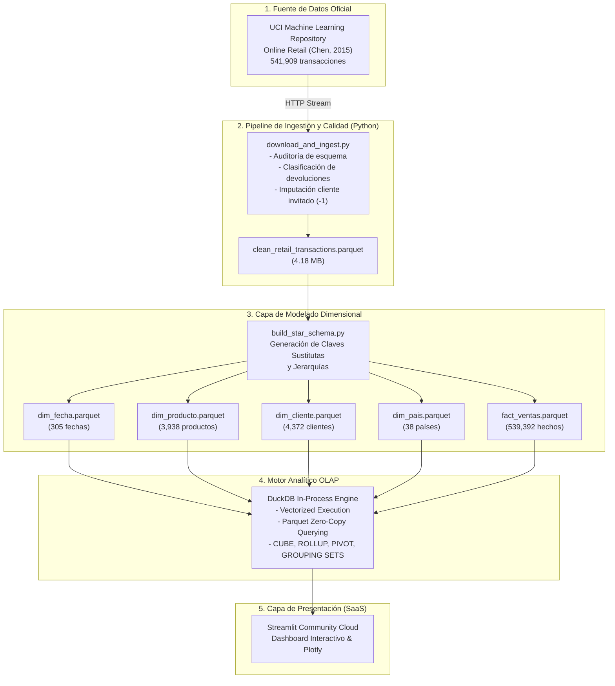
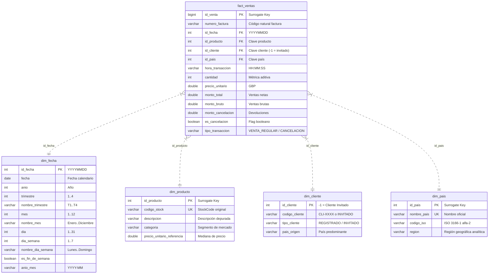

# Arquitectura del Sistema: RetailCube Analytics

## 1. Visión General
**RetailCube Analytics** es una plataforma analítica OLAP (Online Analytical Processing) moderna de alto rendimiento, diseñada bajo principios de arquitectura desacoplada, almacenamiento columnar y procesamiento in-process con software libre.

---

## 2. Decisiones de Arquitectura

### 2.1 ¿Por qué DuckDB en lugar de un RDBMS tradicional o Cloud Data Warehouse?
1. **Motor Columnar In-Process:** DuckDB opera dentro del mismo proceso que la aplicación Python/Streamlit, eliminando la latencia de red de los sockets cliente-servidor (PostgreSQL/MySQL) y evitando costos de infraestructura de servicios cloud como AWS Redshift o Snowflake.
2. **Ejecución Vectorizada:** Utiliza el modelo de ejecución vectorial Morsel-driven, procesando bloques de datos en registros SIMD de la CPU.
3. **Integración Nativa con Apache Parquet:** Puede escanear y filtrar Parquet con proyección de columnas y "predicate pushdown" directamente desde disco o memoria sin deserialización intermedia.
4. **Soporte SQL Estándar Completo para OLAP:** Dispone de sintaxis nativa para operaciones analíticas avanzadas: `ROLLUP`, `CUBE`, `GROUPING SETS` y `PIVOT`.

---

## 3. Esquema Dimensional (Star Schema)

El diseño sigue las metodologías de Ralph Kimball para Data Warehousing empresarial:

---

## 4. Reglas de Negocio e Integridad Analítica

1. **Granularidad Explícita:** Cada registro en `fact_ventas` representa una línea transaccional de una factura.
2. **Tratamiento de Clientes Invitados / No Registrados:** El 24.9% de las transacciones del dataset carecen de `CustomerID`. En lugar de descartarlas (lo que destruiría las métricas de ingresos globales), se asignan al cliente dimensional sustituto `id_cliente = -1`, preservando el 100% de la facturación y la integridad referencial.
3. **Manejo de Devoluciones y Cancelaciones:** Las facturas que comienzan con 'C' o cantidades negativas se clasifican con `es_cancelacion = TRUE`. Se generan medidas independientes:
   - $Ventas\_Brutas = \max(monto\_total, 0)$
   - $Monto\_Cancelacion = |\min(monto\_total, 0)|$
   - $Ventas\_Netas = Ventas\_Brutas - Monto\_Cancelacion$
4. **Métricas No Aditivas:**
   - El *Ticket Promedio* nunca se calcula promediando la columna `monto_total`. Se evalúa como:
     $$\text{Ticket Promedio} = \frac{\sum monto\_total}{\text{COUNT(DISTINCT } numero\_factura)}$$
